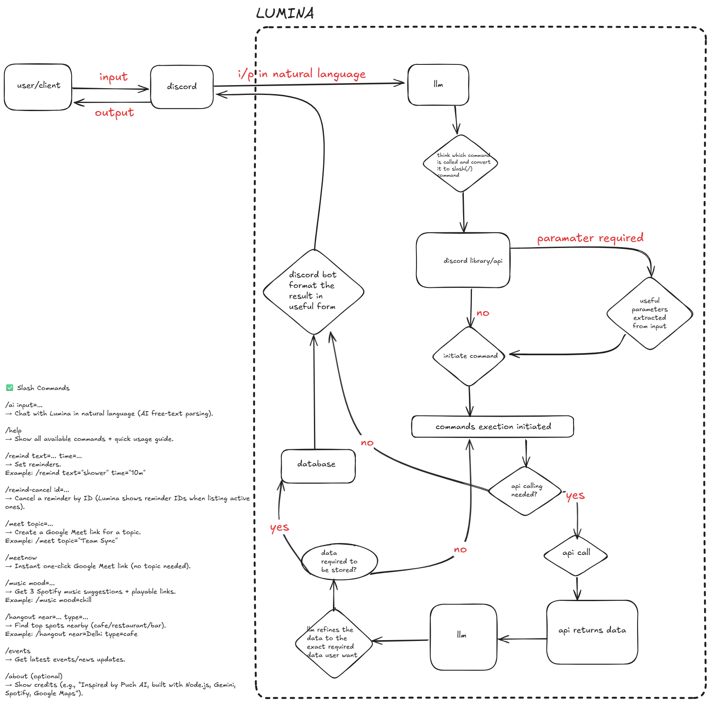

# 🌟 Lumina – Your AI Discord Assistant

Lumina is an **AI-powered Discord assistant** that goes beyond productivity — designed to make every task smarter, smoother, and more fun 🎉.  
From reminders to meet links, music to hangouts, Lumina brings intelligence right inside your Discord server.

---

## 🚀 Get Started

- 🌍 Curious? **Try the public server** → [Join here](https://discord.gg/9m7U5cAs)
- 🔒 Want full control? **Build your own private server** → [Setup guide](https://discord.com/oauth2/authorize?client_id=1410312752840573064&permissions=2147567616&integration_type=0&scope=bot+applications.commands)

---

## ✨ Features

- ⏰ **Reminders** – Set personal reminders that DM you at the right time
- 📅 **Google Meet Integration** – Create Meet links instantly
- 🎵 **Music Suggestions** – Get music recommendations from Spotify
- 📢 **Event Updates** – Fetch upcoming events from Google Calendar
- 🍽️ **Hangout Spots** – Suggest nearby restaurants & places using Google Places API
- 💡 **AI Orchestration** – Natural language → structured intent (powered by LLMs)

---

## 🛠️ Tech Stack

- **Backend Runtime**: Node.js (JavaScript)
- **Database**: MongoDB Atlas (cloud-hosted)
- **AI Integration**: Gemini API (LLM for intent extraction)
- **APIs Used**:
  - Google Calendar + Google Meet API
  - Spotify API
  - Google Places API
- **Scheduling**: `node-cron`
- **Hosting**: Render (free-tier deployment)
- **Secrets Management**: `.env`

---

## 🏗️ Architecture



**High-level flow:**

1. User sends command/message in Discord → Bot receives event
2. Lumina forwards text to LLM → extracts structured intent
3. Intent router → Calls the correct API/service (Reminders, Meet, Music, Places)
4. Response is formatted and sent back to the user in Discord

---

## ⚙️ Setup & Installation

### 1️⃣ Clone the Repository

```bash
git clone https://github.com/your-username/lumina-discord-bot.git
cd lumina-discord-bot
```

### 2️⃣ Install Dependencies

```bash
npm install
```

### 3️⃣ Configure .env File

```bash
# Discord

DISCORD_TOKEN=your_discord_bot_token
DISCORD_CLIENT_ID=your_discord_client_id

# MongoDB

MONGO_URI=your_mongo_connection_string

# Google APIs

GOOGLE_CLIENT_ID=your_google_client_id
GOOGLE_CLIENT_SECRET=your_google_client_secret
GOOGLE_REDIRECT_URI=your_google_redirect_uri

# Spotify

SPOTIFY_CLIENT_ID=your_spotify_client_id
SPOTIFY_CLIENT_SECRET=your_spotify_client_secret
SPOTIFY_REDIRECT_URI=your_spotify_redirect_uri

# AI Model

GEMINI_API_KEY=your_LLM_api_key
```

### 4️⃣ Run the Bot Locally

```bash
npm run dev
```

## 📜 Available Commands

| Command                | Description                                  |
| ---------------------- | -------------------------------------------- |
| `/remind <time> <msg>` | Set a reminder at given time                 |
| `/remainders`          | Show all your active reminders               |
| `/meet`                | Create a Google Meet link                    |
| `/meetnow`             | Instantly start a Google Meet link           |
| `/events`              | Show upcoming Google Calendar events         |
| `/music <mood>`        | Suggest music from Spotify                   |
| `/hangout <location>`  | Recommend restaurants & spots nearby         |
| `/whois <number>`      | Lookup caller information                    |
| `/about`               | Learn more about Taskra (features & credits) |
| `/help`                | List all available commands                  |

---

## 🧪 Development

- Uses **Discord.js v14** for bot interactions
- Commands registered via **Discord slash command API**
- Modular design → easy to extend with new commands

---

## 🚀 Deployment

- **Render/Railway**: Push repo → auto-deploy Node.js app
- Add `.env` secrets in dashboard
- Ensure bot runs 24/7 with health check route `/health`

---

## 🛡️ Security

- No tokens/keys pushed to GitHub → all managed via `.env`
- OAuth2 used for Google & Spotify APIs
- Minimal user data stored in MongoDB (only what’s needed for reminders & tokens)

---

## 📌 Future Improvements

- Multi-language support 🌍
- Web dashboard for settings ⚙️
- More integrations (Notion, Trello, Slack) 📓
- Smarter AI agent reasoning 🤖

---

## 🤝 Credits

Inspired by **Puch AI** and community AI assistants.  
Built with ❤️ for learning and fun.
